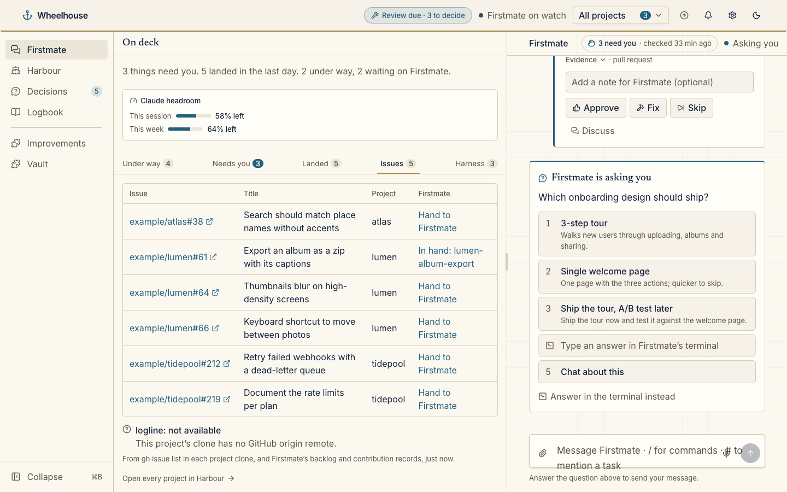
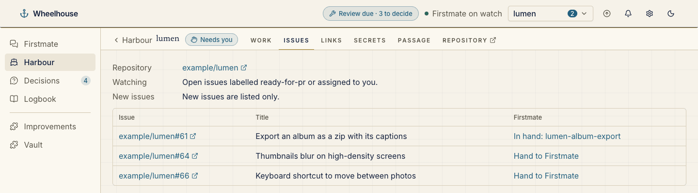

# GitHub issues

The GitHub issues plugin, bundled with Wheelhouse in the installed-plugin format and loaded at startup as built in.

```
.wheelhouse-plugin/plugin.json   the manifest: id, version, contract, entries, enable rule, slots
wheelhouse/server/index.js       providers and contributions (ESM, no dependencies)
```

It lists the open issues in each project's GitHub repository that match the captain's watch rule (by default labelled `ready-for-pr` or assigned to you), marks the ones Firstmate already has in hand, and offers a **Hand to Firstmate** link that only fills the chat's message box. It fills a home rail tab and a project tab, reads through `gh` and one `grep` of Firstmate's records, never asks for an issue's body, and writes nothing. It is off unless your `plugins.json` turns it on.





The `bell` and `auto` modes are not this plugin's doing: plugins cannot ring the bell, and this one does not ask for the `feedback` capability, the only way a plugin messages Firstmate. Wheelhouse's own issue watcher (`src/lib/server/issues/`) reads this plugin's `watch` provider and does both. See [docs/plugins.md](../../docs/plugins.md#github-issues) for the settings and modes.
