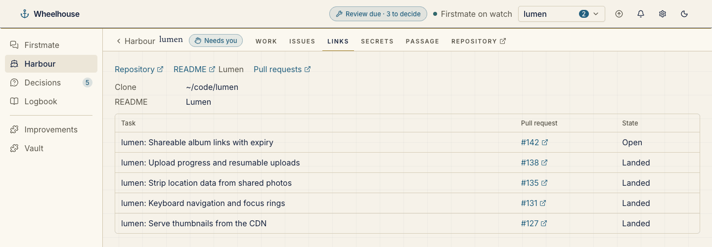
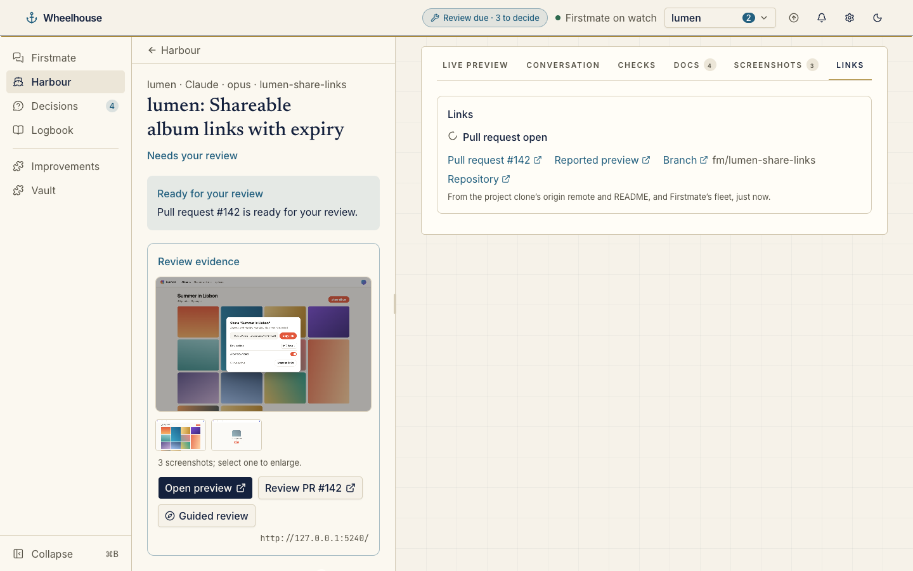

# Project links

The Project links plugin, bundled with Wheelhouse in the installed-plugin format: what a repository looks like when `wheelhouse plugin install <org/repo>` installs it. Wheelhouse ships this folder in its package and loads it at startup through the same loader as an installed plugin, shown as built in.

```
.wheelhouse-plugin/plugin.json   the manifest: id, version, contract, entries, enable rule, slots
wheelhouse/server/index.js       providers and contributions (ESM, no dependencies)
wheelhouse/ui/index.js           <project-links-summary>, the Harbour card, as a custom element
```

It fills a project tab, a Harbour card, a task section, evidence under the Pull request step and a Bridge card, from the project clone's `origin` remote, its README and the fleet. It is off unless your `plugins.json` turns it on. An installed plugin with the id `project-links` is refused while this one is bundled; give it another `name` to try it beside it.





See [docs/plugins.md](../../docs/plugins.md#installed-plugins) for the format.
