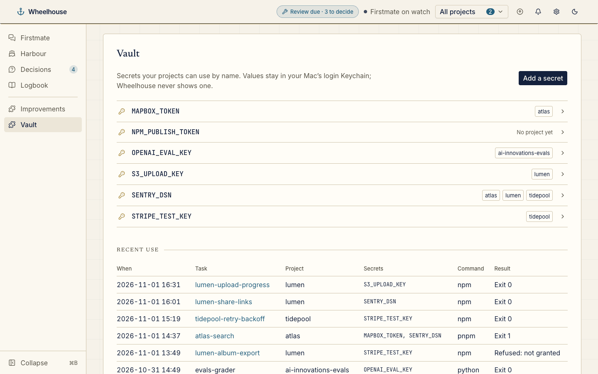
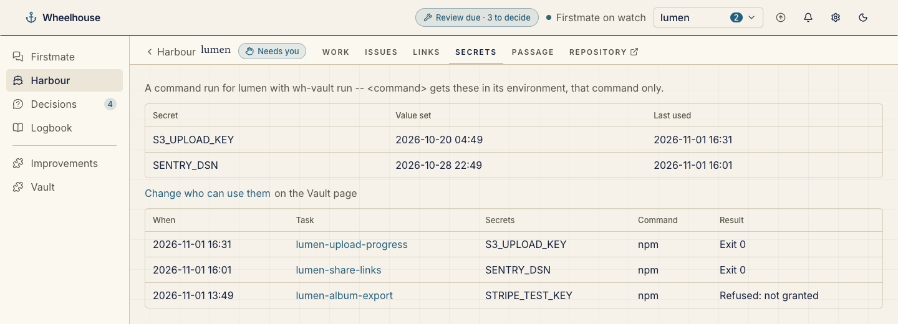

# Vault

The Vault plugin, bundled with Wheelhouse in the installed-plugin format: what [`wh-vault`](../../docs/vault.md) holds, by name only. Wheelhouse ships this folder in its package and loads it at startup through the same loader as an installed plugin, shown as built in.

```
.wheelhouse-plugin/plugin.json   the manifest: id, version, contract, entries, enable rule, slots
wheelhouse/server/index.js       providers and contributions (ESM, no dependencies)
```

It fills a **Vault** page in the menu, a **Secrets** tab on each project with grants or use, and a **Secrets used** tab on each task that ran a command with `wh-vault run`. It reads only by running `wh-vault list --all --json` and `wh-vault audit --json`, neither of which reads a value. It is on by default, and its page shows even while the vault is empty.





The plugin is read-only. Its Vault page is drawn by Wheelhouse's own `vault/overview` panel, which a plugin bundled with Wheelhouse may name. The panel's **Add a secret**, project tick boxes, **Replace value** and **Remove…** go to Wheelhouse (`POST /api/vault`), not to this plugin, and Wheelhouse runs the bundled `wh-vault`. So grants can change from Wheelhouse, any local process that can reach Wheelhouse with its session token could use them, and a value typed there passes briefly through Wheelhouse's process.

See [docs/vault.md](../../docs/vault.md) for `wh-vault` and [docs/plugins.md](../../docs/plugins.md#installed-plugins) for the format.
